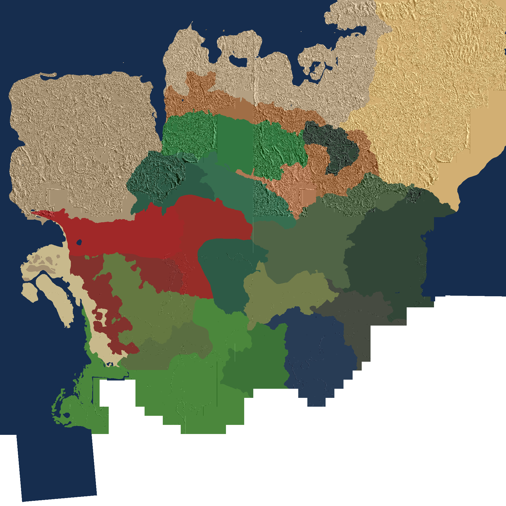

# Satisfactory RWG Interactive Map (`sat-rwg-map`)

A high-performance Rust save parser and interactive web map viewer for modded **Satisfactory** saves generated by the [RandomWorldGenerator (RWG)](https://ficsit.app/mod/RandomWorldGenerator) mod.



## Overview

The `RandomWorldGenerator` mod creates procedural planets with custom terrain, biomes, and resource nodes, embedding large custom binary blocks (`PWEmbeddedWorld`, `PWGenerationParams`) in Satisfactory `.sav` files.

`sat-rwg-map` is a self-contained Rust application that:
- Decompresses Satisfactory binary chunk headers (`0x9E2A83C1`) using `flate2`.
- Safely parses and traverses Unreal Engine property trees, extracting procedural nodes, drop pods, player structures, and world generation parameters.
- Extracts world dimensions (`WorldSizeMeters`, e.g. 12 km) and automatically rescales the textured terrain overlay.
- Hosts an Axum web server providing `GET /api/world` and a rich, interactive Leaflet frontend using Unreal Engine metric space (`L.CRS.Simple`).

---

## Features

- **Fast Save Parsing:** Parses and extracts tens of thousands of actors and objects from modded saves in under 2 seconds.
- **Dynamic Terrain & Shaded Relief:** Embedded high-resolution shaded relief layer extracted from mod assets (`manifest.json`, `height_dm.i16.pwz`, `sea.u8.pwz`, `biome.u8.pwz`) featuring 21 distinct biomes.
- **Automatic World Size Scaling:** Automatically scales terrain bounds to match the save's `WorldSizeMeters` (e.g. 12.0 km, 7.1 km, 16.0 km) with live scale presets and sliders.
- **Resource Filtering & Badges:** Toggle individual resource categories (Iron, Copper, Coal, Crude Oil, SAM, Uranium, etc.) with purity badges (Pure, Normal, Impure).
- **Special Markers:** Real-time Pioneer pulsing position indicator and Drop Pod crash sites with power requirements.
- **Fully Self-Contained Binary:** Frontend and terrain textures are embedded via `include_str!` and `include_bytes!`—no external assets required at runtime.

---

## Getting Started

### Prerequisites
- [Rust Toolchain](https://rustup.rs/) (1.80+ recommended)
- Satisfactory save file (`.sav`) in the `samples/` directory

### Build & Run

```powershell
# Build optimized release binary
cargo build --release

# Run server (listens on http://127.0.0.1:8080)
.\target\release\sat-rwg-map.exe
```

Open `http://127.0.0.1:8080` in your web browser.

---

## API Endpoints

- `GET /`: Interactive Leaflet map viewer.
- `GET /api/status`: Health check, session name, world seed, and total node count.
- `GET /api/world`: Full JSON snapshot containing world bounds, nodes, player location, and drop pods.
- `GET /static/landmass.png`: High-resolution shaded relief terrain layer.

---

## Running Tests

```powershell
cargo test
```
All parser benchmarks and Axum endpoint integration tests run automatically against sample saves.
